# 2526_ESE_AAA_Najd-BEN-SAAD_Yassin-GARAFI

**TP Actionneurs et Automatique Appliquée — 3ème année ESE (ENSEA)**  
**Binôme :** Najd BEN SAAD & Yassin GARAFI  
**Encadrant :** Alexis Martin  

---

## 1. Objectif et matériel

L'objectif du TP est de piloter un moteur à courant continu (`48 V / 12 A`) avec un hacheur en pont complet commandé par une **Nucleo-STM32G474RE** :
1. Générer 4 signaux PWM en commande complémentaire décalée avec temps mort.
2. Mesurer le courant (ADC + DMA synchronisés sur la PWM) et la vitesse (codeur incrémental).
3. Mettre en place un asservissement en courant et en vitesse.

| Banc d'essai | Alimentation bus continu (`48 V`) |
| :---: | :---: |
| 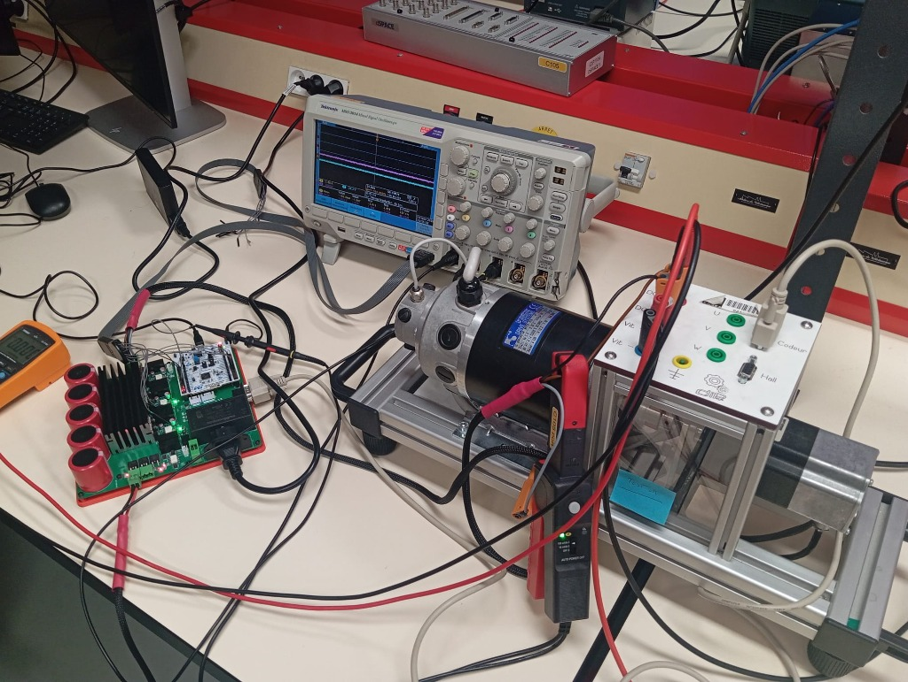 | 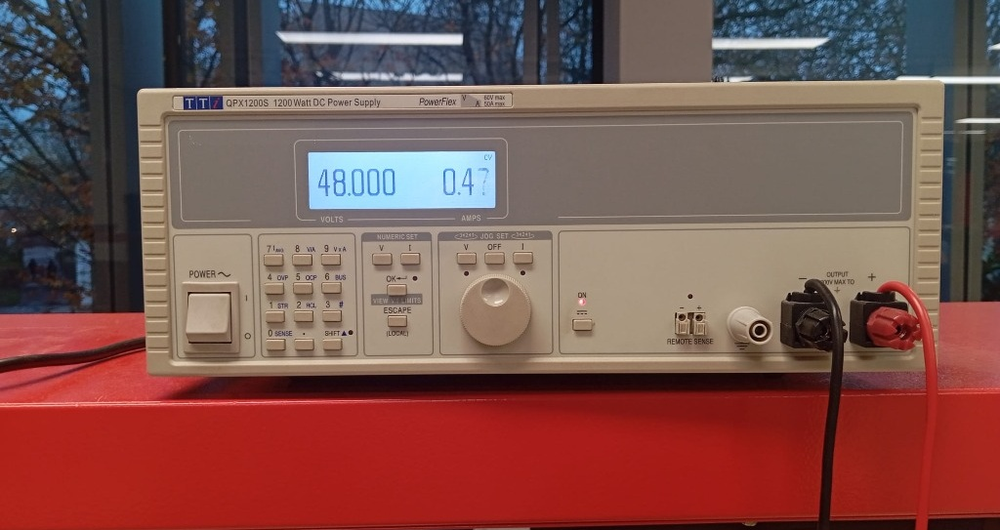 |

---

## 2. Organisation des fichiers (`software/Base/Core`)

* `Src/app.c` : initialisation des modules (`init_device()`) et boucle principale (`loop()`).
* `Src/user_interface/shell.c` : terminal UART2 (`115200 bauds, 8N1`) en interruption.
* `Src/user_interface/led.c` : contrôle de la LED utilisateur (`PA5`).
* `Src/motor_control/motor.c` : gestion des 4 PWM sur `TIM1` et rampe d'accélération.
* `Src/motor_control/asserv.c` : correcteurs PID (`speed`, `current`, `cascade`) sur `TIM7`.
* `Src/acquisition/input_analog.c` : mesure des courants par `ADC1` + `DMA` sur `TIM1_TRGO`.
* `Src/acquisition/input_encoder.c` : mesure de vitesse par codeur sur `TIM3` et `TIM7` ($100\text{ Hz}$).

---

## 3. Commandes du Shell UART

Le pilotage se fait via le shell UART2 (`115200 bauds`). Taper `help` dans le terminal affiche la liste des commandes disponibles :

| Commande | Syntaxe | Description |
| :--- | :--- | :--- |
| `help` | `help` | Liste les commandes disponibles |
| `led` | `led on` ou `off` ou `toggle` | Contrôle la LED verte (`PA5`) |
| `start` | `start` | Active les 4 PWM à 50% (`CCR = 2125`, vitesse nulle) |
| `stop` | `stop` | Coupe les 4 sorties PWM (garde `TIM1` actif pour l'ADC) |
| `speed` | `speed <val>` ou `speed <val%>` | Consigne boucle ouverte avec rampe (`0..4249` ou `0%..100%`) |
| `SET_CCR` | `SET_CCR <val>` ou `SET_CCR <val%>` | Même fonction que `speed` |
| `current` | `current` | Affiche `I_U` et `I_bus` en mA + valeurs ADC brutes |
| `vitesse` / `enc` | `vitesse` ou `enc` | Affiche la vitesse (`tr/min`), `delta` et `TIM3->CNT` |

---

## 4. Commande MCC basique (Partie 6)

### 6.1. Génération de 4 PWM

Configuration de `TIM1` :
* **Fréquence :** $f_{\text{PWM}} = 20\text{ kHz}$ ($T = 50\ \mu\text{s}$), avec $f_{\text{TIM1}} = 170\text{ MHz}$ et `Prescaler = 0`.
* **Mode :** centre-aligné (`TIM_COUNTERMODE_CENTERALIGNED1`, compteur triangle $0 \rightarrow \text{ARR} \rightarrow 0$).
* **Période (`ARR`) :**

$$
\text{ARR} = \frac{170\text{ MHz}}{2 \times 20\text{ kHz}} - 1 = 4250 - 1 = 4249
$$
* **Résolution :** $\log_2(4250) \approx 12\text{ bits}$ (supérieure aux 10 bits demandés).
* **Temps mort :** d'après la datasheet des MOSFETs **IRF540N** ($t_{d(\text{off})} \approx 39\text{ ns}$, $t_f \approx 35\text{ ns}$) et des optocoupleurs **HCPL-315J**, on a réglé `DeadTime = 34` dans `tim.c` ($\approx 200\text{ ns}$ à $170\text{ MHz}$, selon le registre `TIMx_BDTR`).

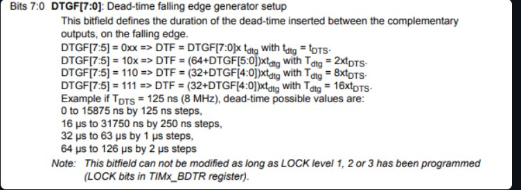

**Broches utilisées :**
* Bras U : `PA8` (`TIM1_CH1`) et `PB13` (`TIM1_CH1N`)
* Bras V : `PA9` (`TIM1_CH2`) et `PB14` (`TIM1_CH2N`)

| Schéma PWM & pont en H | 4 PWM à 50% ($20\text{ kHz}$) | Zoom sur les temps morts |
| :---: | :---: | :---: |
| 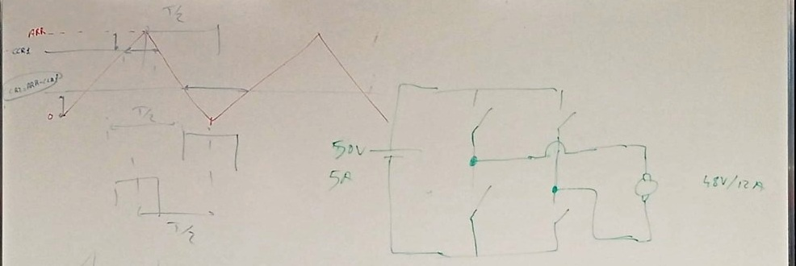 | 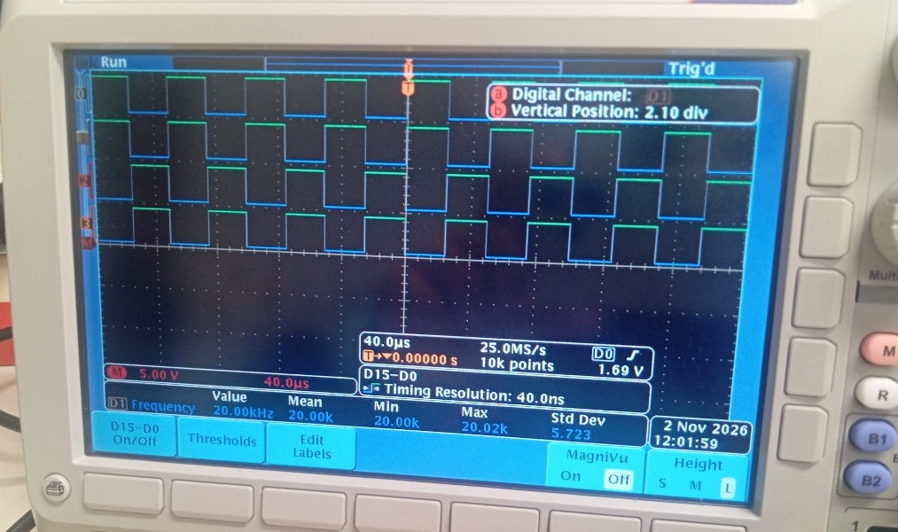 | 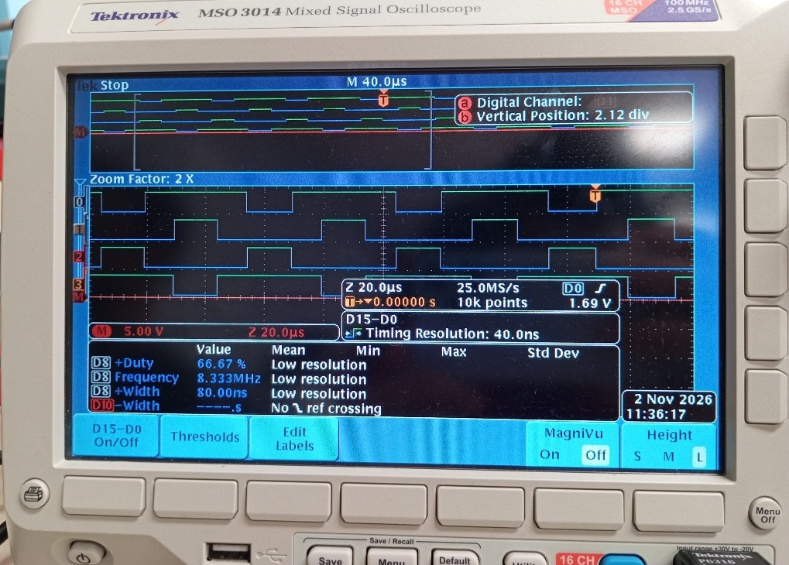 |

---

### 6.2. Commande de vitesse (`SET_CCR`)

La commande `SET_CCR XXXX` permet de modifier le rapport cyclique par UART :
1. Détection de la commande `SET_CCR`.
2. Vérification des bornes ($0$ à $4249$) : si la valeur dépasse `4249`, la commande est refusée pour protéger le pont.
3. Application en commande complémentaire décalée sur les deux bras :
   * `CCR1 = consigne` (bras U)
   * `CCR2 = 4249 - consigne` (bras V)

À 50% (`CCR1 = 2125`, `CCR2 = 2124`), la tension moyenne aux bornes du moteur est nulle. À 70% (`CCR1 = 2974`, `CCR2 = 1275`), le moteur tourne en marche avant.

| Test `SET_CCR 2974` sur Tera Term | 4 PWM décalées ($20{,}02\text{ kHz}$) |
| :---: | :---: |
| 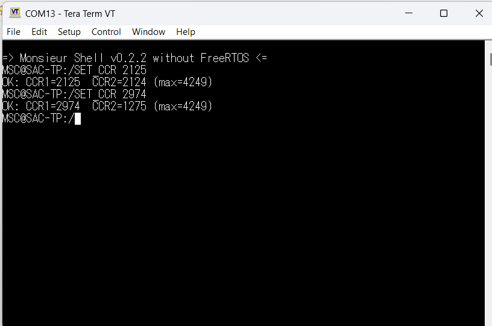 | 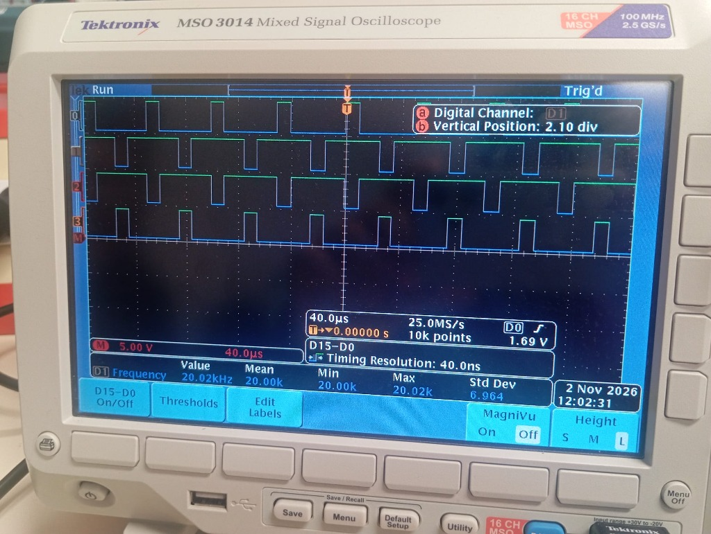 |

---

### 6.3. Premiers tests (50% puis 70%)

En passant directement de 50% à 70%, on observe un **appel de courant important** au démarrage (la FCEM est nulle à l'arrêt, donc $I = U / R$ est grand) et un à-coup sur l'arbre moteur.  
Pour éviter cela, on a ajouté une **rampe progressive** entre le CCR actuel et la consigne cible.

| PWM à 50% (`49,60%`, $20\text{ kHz}$) | PWM décalées en fonctionnement |
| :---: | :---: |
| 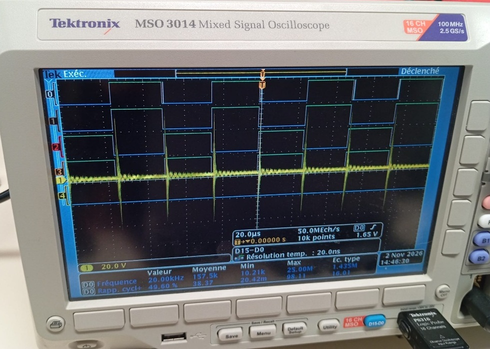 | 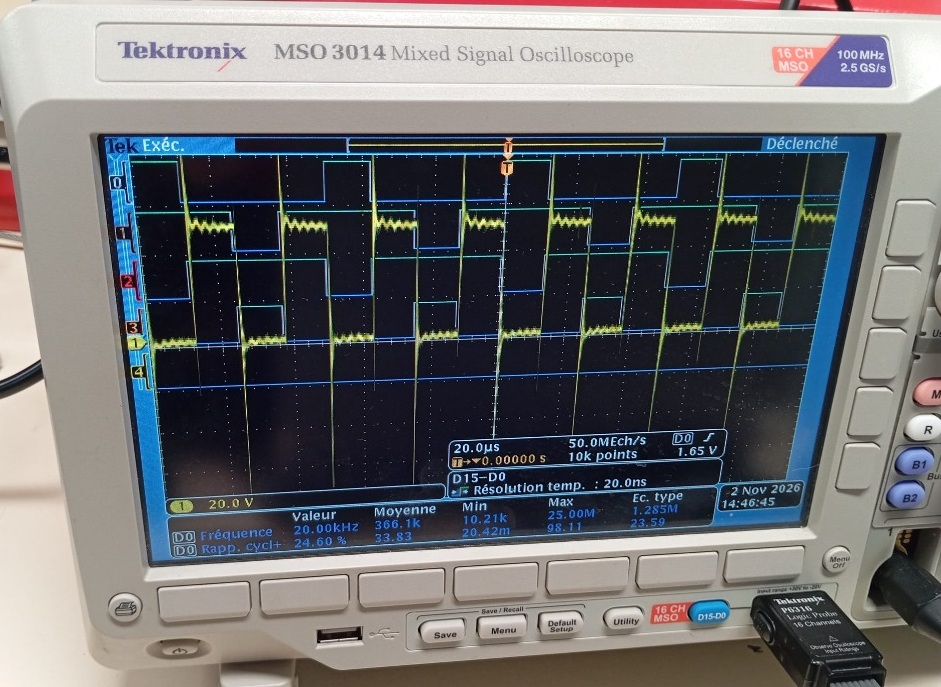 |

---

## 5. Boucle ouverte, mesure de courant et de vitesse (Partie 7)

### 7.1. Commande de la vitesse (`start`, `stop`, `speed`)

* `start` : met les PWM à 50% (`CCR = 2125`, vitesse nulle) et démarre les 4 sorties (`HAL_TIM_PWM_Start` et `HAL_TIMEx_PWMN_Start`).
* `stop` : coupe les 4 sorties PWM tout en gardant le compteur `TIM1` actif (`__HAL_TIM_ENABLE(&htim1)`) pour continuer à déclencher l'ADC.
* `speed` : fixe la consigne cible et fait varier progressivement le rapport cyclique (rampe de 10 ticks toutes les 10 ms) pour éviter les pics de courant.

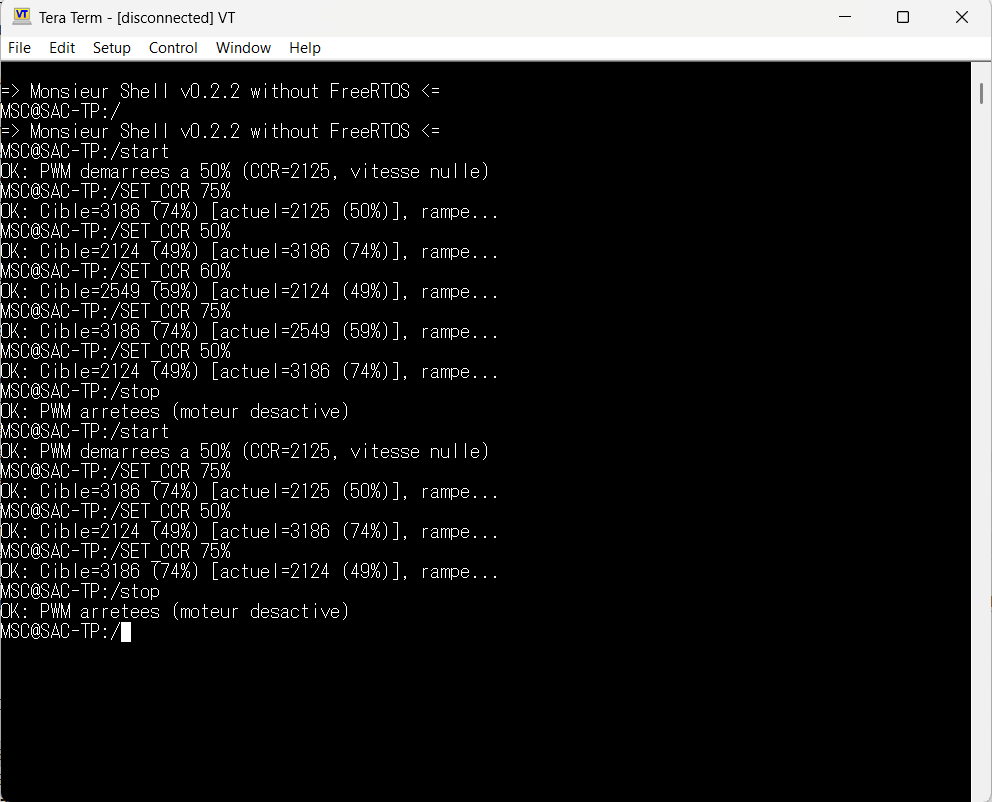

---

### 7.2. Mesure de courant

#### Courants mesurés et broches STM32
D'après le schéma KiCad :
* **Courant de phase moteur $I_U$ (`U_Imes`)** : broche **`PA1`** (`ADC1_IN2`).
* **Courant du bus continu $I_{\text{bus}}$ (`Bus_Imes`)** : broche **`PC2`** (`ADC1_IN8`).

#### Fonction de transfert du capteur
Les capteurs utilisés sont des **LEM GO 10-SME/SP3** alimentés en $3{,}3\text{ V}$ :
* Tension de repos à $0\text{ A}$ : $V_{\text{offset}} = 1{,}65\text{ V}$ ($\pm 20\text{ mV}$ selon datasheet).
* Sensibilité : $S = 50\text{ mV/A} = 0{,}050\text{ V/A}$.
* Formule :

$$
V_{\text{out}} = 1{,}65 + 0{,}050 \cdot I \quad \text{donc} \quad I\text{ [A]} = 20 \cdot (V_{\text{out}} - 1{,}65)
$$

* Sur l'ADC 12 bits ($0$ à $4095$ pour $0$ à $3{,}3\text{ V}$) :

$$
V_{\text{out}}\text{ [mV]} = \frac{\text{ADC} \times 3300}{4095}, \qquad I\text{ [mA]} = (V_{\text{out}}\text{ [mV]} - 1650) \times 20
$$

#### Polling puis chaîne `TIM1 + ADC1 + DMA`
* Une première version en Polling a validé l'offset au repos (`ADC ≈ 2060`, soit $\approx 1{,}66\text{ V}$) et la montée du courant en charge.
* L'acquisition finale utilise `ADC1` en mode Scan (2 canaux) déclenché par `TIM1_TRGO` ($40\text{ kHz}$) avec transfert par **DMA circulaire**.

| Terminal (`current` à 70%) | Oscillo pince ampèremétrique (`Mean = 2.065 A`) |
| :---: | :---: |
| 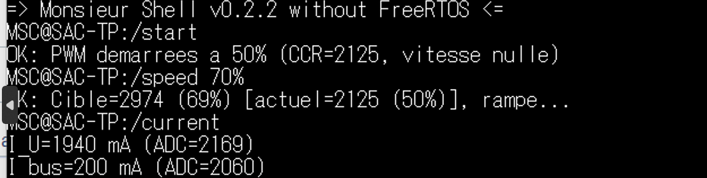 | 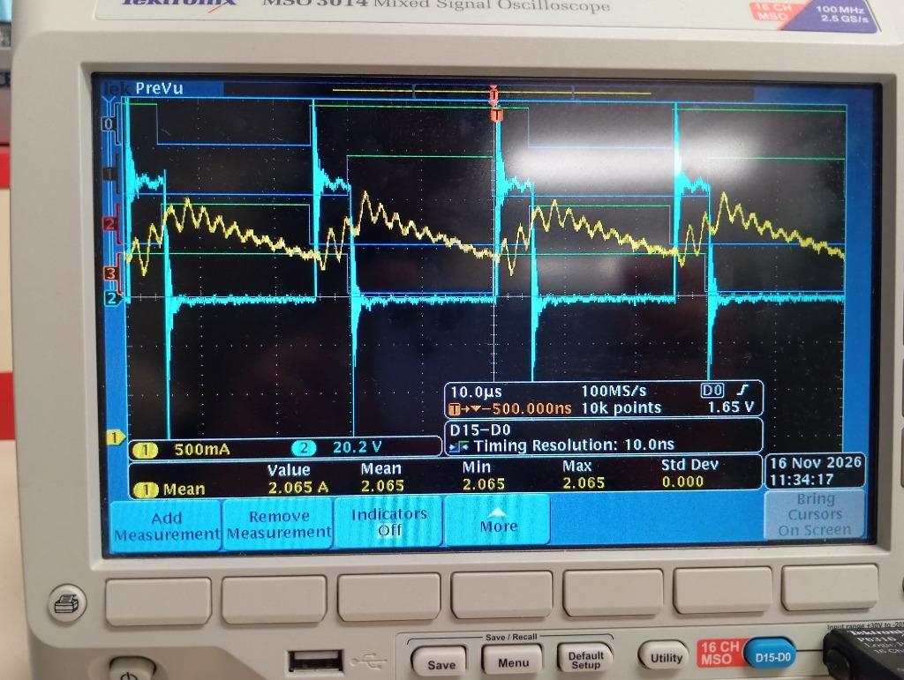 |

---

### 7.3. Mesure de vitesse

#### Capteur et broches
* Le codeur différentiel est lu via le récepteur **MAX3097ECSE+**.
* Broches sur `TIM3` configuré en mode encodeur quadrature `TI12` ($\times 4$) :
  * `ENC_A` : `PA6` (`TIM3_CH1`)
  * `ENC_B` : `PA4` (`TIM3_CH2`)
  * `ENC_Z` : `PC8` (`TIM3_CH3`)
* Résolution du codeur : `1024 PPR`, soit $4 \times 1024 = 4096\text{ ticks/tour}$.

#### Échantillonnage (`TIM7`) et méthode du point milieu
* `TIM7` génère une interruption toutes les **$10\text{ ms}$** ($f_e = 100\text{ Hz}$, `Prescaler = 169`, `Period = 9999`).
* On utilise la **méthode du point milieu (`32768`)** pour éviter les débordements du compteur 16 bits :
  1. `TIM3->CNT` est initialisé à `32768`.
  2. Toutes les $10\text{ ms}$ (dans l'IT `TIM7`), on lit `CNT`, on calcule `delta = CNT - 32768`, puis on remet `TIM3->CNT = 32768`.
  3. Calcul de la vitesse :

$$
N\text{ [tr/min]} = \frac{\text{delta} \times 100 \times 60}{4096}
$$

| Méthode du point milieu (tableau) | Tests courant et vitesse (`60%`, `40%`, `stop`) |
| :---: | :---: |
| 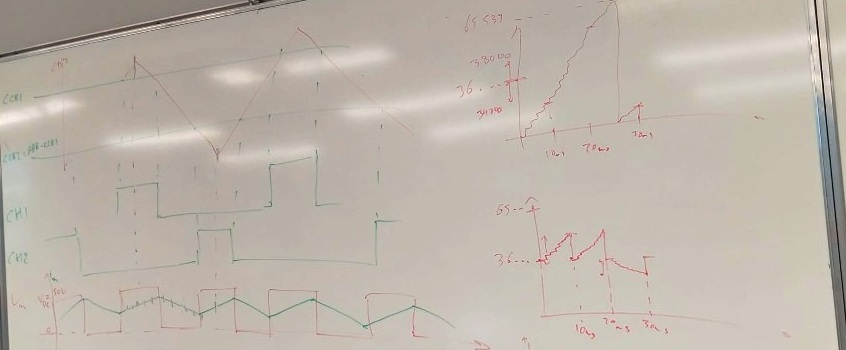 | 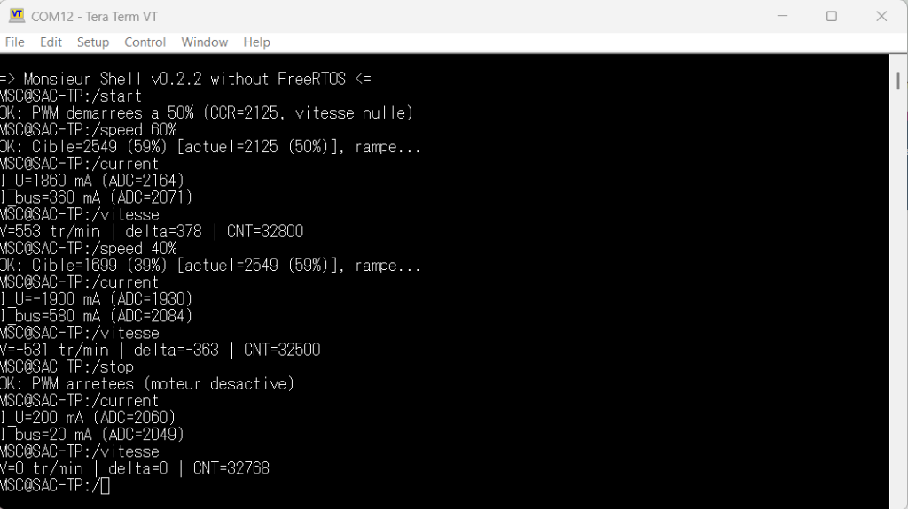 |

---

## 6. Asservissement PID (`asserv.c`)

> **Note :** Cette partie a été implémentée dans le code (`asserv.h` / `asserv.c`), mais **n'a pas encore été testée sur le banc d'essai**.

* Correcteur PID avec anti-windup exécuté à $100\text{ Hz}$ sur `TIM7`.
* Commande `asserv` : `asserv speed <rpm>`, `asserv current <mA>`, `asserv cascade <rpm>`, `asserv off` (et `asserv` sans argument pour afficher l'état).
* Commande `pid` : `pid speed <kp_m> <ki_m> <kd_m>` ou `pid current <kp_m> <ki_m> <kd_m>` (gains en millièmes, ex : `1500` pour `1.5`).

Exemple de test en vitesse (`500 tr/min`) :
```text
start
asserv speed 500
asserv
asserv off
stop
```
